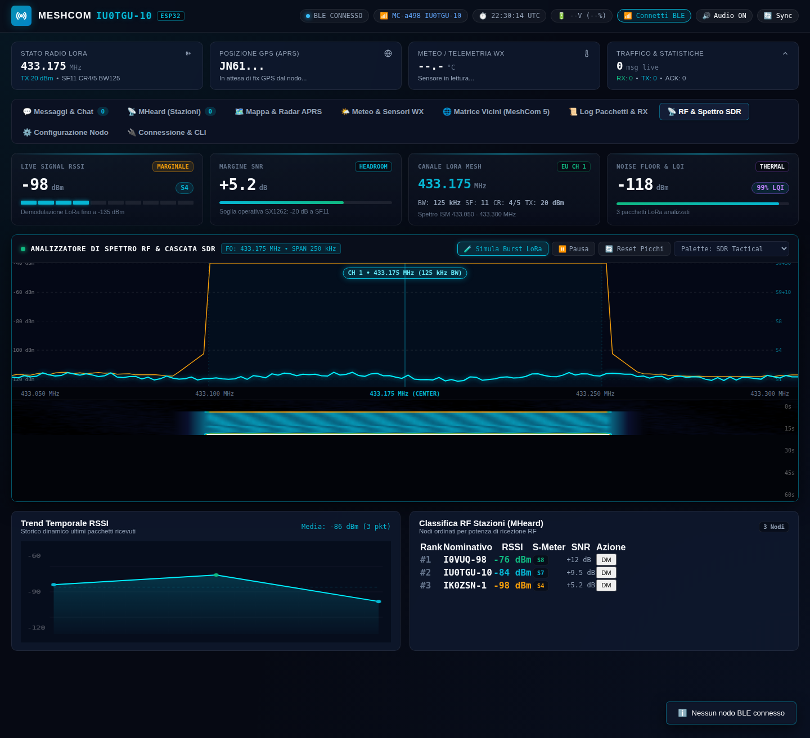

# 📡 MeshCom Tactical Pro Web Dashboard

[](https://meshcom.net)
[]()
[]()
[]()

Dashboard Web tattica di nuova generazione con design **Dark Glassmorphism** e supporto nativo **Web Bluetooth (BLE)** per nodi radioamatoriali **MeshCom 4.x / 5.x** (ESP32-S3, Heltec V2/V3, LilyGO T-Beam, T-Deck, RAK, ecc.).

Sostituisce e potenzia le interfacce standard offrendo una suite operativa completa per il traffico radio LoRa, la telemetria, il tracciamento APRS satellitare e l'analisi RF spettrale SDR.

---

## 📸 Anteprima Spettro RF SDR & Cascata (Waterfall)



---

## ⚡ Caratteristiche Principali

1. **💬 Chat & Gestione Canali**:
   - Ricezione e trasmissione su canali LoRa Broadcast (`*`), Nazionali (`222` / `22251`), Emergenza (`999`) e messaggi diretti (DM).
   - **Zero caratteri corrotti**: Decodifica binaria nativa del protocollo APRS con stripping dei byte di coda e gestione frame ACK (`0x41`) con conferme di consegna grafiche (`✓✓`).

2. **📡 Analizzatore di Spettro RF SDR & Cascata (Waterfall)**:
   - Traccia FFT dinamica a 60 FPS con bagliore al neon ciano e simulazione del rumore termico.
   - Traccia ambra dei massimi (*Peak-Hold*) per visualizzare l'inviluppo di trasmissione LoRa (125 kHz BW).
   - Cascata SDR scorrevole con palette selezionabili (*Tactical SDR*, *Heatmap Termica*, *Fosfori Verdi*).
   - Metriche RF: lettura RSSI, **S-Meter radioamatoriale standard IARU**, margine SNR e Noise Floor.
   - Pulsante `🧪 Simula Burst LoRa` per testare la grafica e la reattività in tempo reale.

3. **🗺️ Mappa APRS Satellitare HD Offline**:
   - Tracciamento stazioni e beacon GPS vettoriali in tempo reale.
   - Layer cartografici ad alta risoluzione **100% gratuiti e senza API key**: *Esri World Imagery (Satellite HD)*, *OpenStreetMap* e *OpenTopoMap*.

4. **🌤️ Telemetria Sensori & Meteo WX**:
   - Monitoraggio sensori ambientali (temperatura, umidità, pressione barometrica, quota altimetrica) e telemetria energetica (tensione e percentuale batteria).

5. **🌐 Matrice Vicini (MeshCom 5)**:
   - Matrice dei nodi della maglia radio con statistiche di qualità del collegamento (LQI).

6. **📜 Log Pacchetti & Ispettore RX**:
   - Log dettagliato di ogni singolo frame ricevuto con Dump Esadecimale (HEX) e download del log in formato `.txt`.

7. **⚙️ Configurazione Completa Nodo**:
   - Impostazione rapida di Nominativo (Callsign con SSID), testo beacon APRS, parametri RF (frequenza, potenza TX, Spreading Factor), GPS, Wi-Fi e riavvio remoto.

8. **🔌 Connessione Hardware Ibrida & Terminale CLI**:
   - Connessione diretta **Bluetooth Low Energy (Nordic UART Service)**.
   - Connessione di rete **Wi-Fi / REST HTTP**.
   - Terminale per inviare qualsiasi comando CLI nativo a MeshCom.

---

## 🚀 Come Eseguire il Progetto

### Opzione 1: GitHub Pages (Consigliato per mobilità su qualsiasi PC o Smartphone)
La dashboard è un'applicazione Web autonoma. Se attivata su **GitHub Pages**:
1. Nel tuo repository su GitHub, vai in **Settings** > **Pages**.
2. Sotto **Build and deployment**, seleziona il branch `main` e la cartella `/ (root)`, poi clicca **Save**.
3. In meno di un minuto avrai un link protetto **HTTPS** (es. `https://<tuo-utente>.github.io/<tuo-repo>/`).
4. Aprendo quel link da qualsiasi computer o smartphone Android (con Chrome o Edge), potrai connetterti al nodo via Bluetooth istantaneamente senza dover installare nulla!

### Opzione 2: Esecuzione in Locale
Puoi clonare il repository su qualsiasi computer (Linux, macOS, Windows):

```bash
# 1. Clona il repository
git clone https://github.com/<TUO-USERNAME>/meshcom-tactical-dashboard.git
cd meshcom-tactical-dashboard

# 2. Avvia il server locale
python3 start_dashboard.py
```

Apri quindi il browser su **`http://localhost:8080`**.

---

## 🌐 Compatibilità Bluetooth (Web Bluetooth)

- **Desktop**: Google Chrome, Microsoft Edge, Opera, Brave (abilitando Bluetooth).
- **Android**: Google Chrome, Microsoft Edge, Samsung Internet.
- **Linux**: Richiede Bluetooth attivo e BlueZ (in esecuzione di default su tutte le distribuzioni moderne).
- **iOS (iPhone/iPad)**: Safari non supporta Web Bluetooth di default; utilizzare browser compatibili come **Bluefy** o **WebBLE**.

---

## 📄 Licenza
Rilasciato per la community radioamatoriale mondiale. 73 de IU0TGU!
