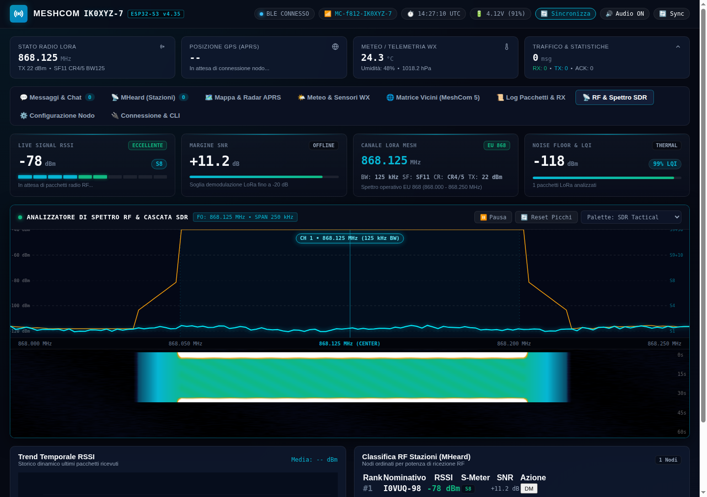
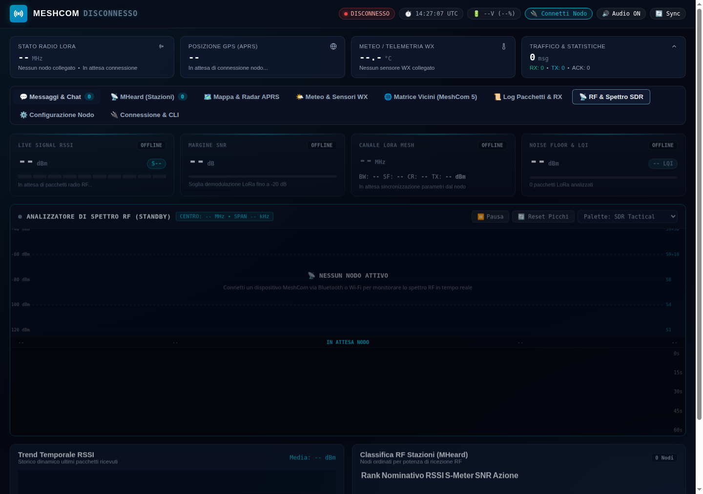
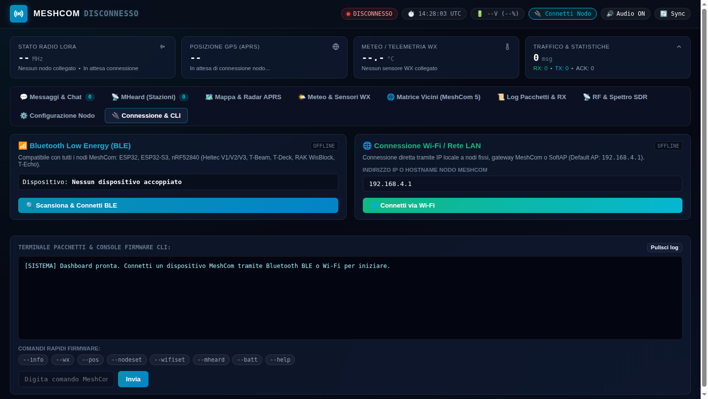
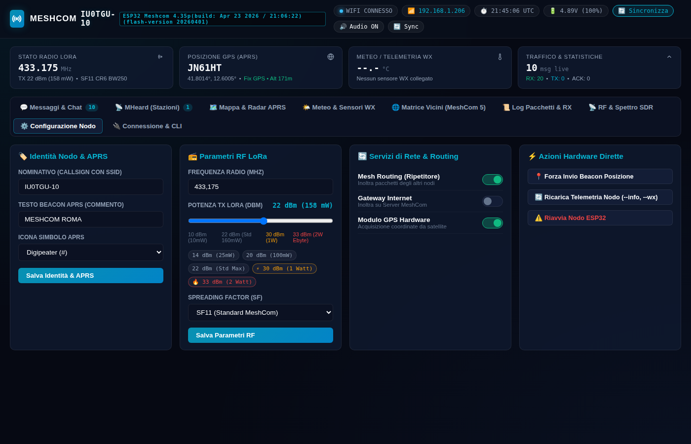

# 📡 MeshCom Tactical Pro Web Dashboard

[](https://meshcom.net)
[]()
[]()
[]()
[]()

Dashboard Web tattica di nuova generazione con design **Dark Glassmorphism**, supporto **Web Bluetooth (BLE)** e **Wi-Fi REST/LAN** per nodi radioamatoriali **MeshCom 4.x / 5.x** (ESP32, ESP32-S3, Heltec V1/V2/V3, LilyGO T-Beam, T-Deck, RAK WisBlock, T-Echo, RP2040, ecc.).

Sostituisce e potenzia le interfacce standard offrendo una suite operativa completa per il traffico radio LoRa, la telemetria, il tracciamento APRS satellitare e l'analisi RF spettrale SDR.

---

## 📸 Anteprime Interfaccia

### 1. Spettro RF SDR & Cascata (Waterfall) in Ricezione Live


### 2. Standby Pulito a Riposo (Zero Dati Simulati quando Disconnesso)


### 3. Connessione Dual-Mode: Bluetooth Low Energy + Wi-Fi / LAN REST


### 4. Controllo Potenza TX Dinamico (10-33 dBm) & Preset Amplificatore PA (Ebyte E22 1W/2W)


---

## ⚡ Caratteristiche Principali

1. **🛡️ Zero Finzioni & Standby Pulito**:
   - Quando nessun dispositivo è collegato, la dashboard non mostra finte frequenze, finti callsign né barre casuali: rimane in elegante standby tattico con avvisi chiari.
   - Tutti i parametri (nominativo, frequenza, potenza TX, sensori meteo e coordinate GPS) vengono popolati **esclusivamente dai dati reali** trasmessi dal nodo.

2. **🌍 Compatibilità Hardware & Frequenze Universale**:
   - **Auto-Detection Microcontrollore**: Riconosce automaticamente **ESP32**, **ESP32-S3** (Heltec V3, T-Beam Supreme, T-Deck), **nRF52840** (RAK4631, T-Echo) e **RP2040**.
   - **Tutte le Bande Mondiali**: Si adatta istantaneamente a frequenze **433 MHz** (EU), **868 MHz** (EU), **915 MHz** (US/AU) o frequenze personalizzate, riallineando dinamicamente la frequenza centrale e le scale graduate dello spettro.

3. **🔌 Connessione Hardware Ibrida (BLE + Wi-Fi)**:
   - **Bluetooth Low Energy (BLE)**: Scansione tramite Nordic UART Service (NUS) compatibile con tutti i moduli portatili.
   - **Wi-Fi / Rete LAN**: Connessione diretta tramite IP locale a nodi fissi, gateway o SoftAP (default `192.168.4.1`) con polling delle API REST native.
   - Terminale integrato per comandi CLI diretti (`--info`, `--wx`, `--pos`, `--nodeset`, `--wifiset`, `--mheard`, `--batt`, `--help`).

4. **⚡ Regolazione Potenza RF Estesa (10 - 33 dBm)**:
   - Slider di controllo fine per la potenza di trasmissione da 10 dBm fino a 33 dBm (2 Watt RF).
   - Preset rapidi per moduli LoRa standard e ad alta potenza: **Standard (14-22 dBm)**, **Ebyte E22 1W (30 dBm)** ed **Ebyte E22 2W (33 dBm)**.
   - Algoritmo di sicurezza che limita il pilotaggio del chip SX1262/SX1268 a 22 dBm per prevenire saturazione e danneggiamento dello stadio finale PA.

5. **💬 Chat & Gestione Canali**:
   - Ricezione e trasmissione su canali LoRa Broadcast (`*`), Nazionali (`222` / `22251`), Emergenza (`999`) e messaggi diretti (DM).
   - **Zero caratteri corrotti**: Decodifica binaria nativa del protocollo APRS con rimozione dei byte di coda e gestione frame ACK (`0x41`) con conferme grafiche (`✓✓`).

6. **📡 Analizzatore di Spettro RF SDR & Cascata (Waterfall)**:
   - Traccia FFT dinamica a 60 FPS con bagliore neon ciano e inviluppo ambra dei picchi (*Peak-Hold*) per visualizzare la sagoma del chirp LoRa (125 kHz BW).
   - Cascata SDR scorrevole con palette selezionabili (*Tactical SDR*, *Heatmap Termica*, *Fosfori Verdi*).
   - Metriche RF: lettura RSSI, **S-Meter radioamatoriale standard IARU**, margine SNR e Noise Floor.
   - Trend temporale degli ultimi 40 pacchetti e classifica nodi ordinata per intensità con tasto rapido `DM`.

7. **🗺️ Mappa APRS Satellitare HD Offline**:
   - Tracciamento stazioni e beacon GPS vettoriali in tempo reale.
   - Layer cartografici ad alta risoluzione **100% gratuiti e senza API key**: *Esri World Imagery (Satellite HD)*, *OpenStreetMap* e *OpenTopoMap*.

8. **🌤️ Telemetria Sensori & Meteo WX**:
   - Monitoraggio sensori ambientali reali (temperatura, umidità, pressione barometrica, quota altimetrica) ed energetici (tensione e percentuale batteria).

9. **🌐 Matrice Vicini (MeshCom 5)**:
   - Matrice dei nodi adiacenti con statistiche di qualità del collegamento radio (LQI).

---

## 🚀 Come Eseguire il Progetto

### Opzione 1: GitHub Pages (Consigliato per mobilità su qualsiasi PC o Smartphone)
La dashboard è un'applicazione Web autonoma. Se attivata su **GitHub Pages**:
1. Nel tuo repository su GitHub, vai in **Settings** > **Pages**.
2. Sotto **Build and deployment**, seleziona il branch `main` e la cartella `/ (root)`, poi clicca **Save**.
3. In meno di un minuto avrai un link protetto **HTTPS** (es. `https://<tuo-utente>.github.io/<tuo-repo>/`).
4. Aprendo quel link da qualsiasi computer o smartphone Android (con Chrome o Edge), potrai connetterti al nodo via Bluetooth istantaneamente senza dover installare nulla!

### Opzione 2: Esecuzione in Locale
Puoi clonare il repository su qualsiasi computer (Linux, macOS, Windows):

```bash
# 1. Clona il repository
git clone https://github.com/dmalaboratory/8bit_meshcom.git
cd 8bit_meshcom

# 2. Avvia la dashboard locale
python3 start_dashboard.py
```

Apri quindi il browser su **`http://localhost:8080`**.

---

## 🌐 Compatibilità Bluetooth (Web Bluetooth)

- **Desktop**: Google Chrome, Microsoft Edge, Opera, Brave (abilitando Bluetooth).
- **Android**: Google Chrome, Microsoft Edge, Samsung Internet.
- **Linux**: Richiede Bluetooth attivo e BlueZ (in esecuzione di default su tutte le distribuzioni moderne).
- **iOS (iPhone/iPad)**: Safari non supporta Web Bluetooth di default; utilizzare browser compatibili come **Bluefy** o **WebBLE**.

---

## 🛠️ Hardware & Progetti PCB (E22 DevBoard & Roadmap)

Il repository include i sorgenti completi per la progettazione e la fabbricazione del nodo hardware ad alta potenza, situati nella cartella [`hardware/`](hardware/):

| Vista Assonometrica 3D | Layout Circuitale PCB |
| :---: | :---: |
|  |  |

### 📌 Caratteristiche Hardware (Release Rev 1.0)
- **Microcontrollore**: ESP32 DevKitC v4 (ESP32-WROOM-32 / D0WD-V3).
- **Modulo LoRa High-Power**: Ebyte E22-400M30S (433 MHz, SX1268) / E22-900M30S (868/915 MHz, SX1262) con supporto trasmissione fino a **+30 / +33 dBm (1W / 2W)**.
- **Porta USB-C Nativa**: Con resistori di terminazione **5.1 kΩ su CC1/CC2** per piena compatibilità con alimentatori USB-PD e cavi Type-C moderni.
- **Alimentazione Robusta**: LDO 3.3V ad alta corrente (1.5A continui) dimensionato per sostenere i transienti di picco della trasmissione RF senza cadute di tensione o reset.
- **Header Espansione I2C**: Pinout standard **`GND — VCC (3.3V) — SCL — SDA`** per display OLED SSD1306/SH1106 e sensori meteo BME280.

### 📁 Risorse di Produzione Incluse nel Repository
- **File di Progetto KiCad**: [`hardware/KiCad/`](hardware/KiCad/) (schema elettrico, netlist, sbroglio PCB).
- **Pacchetto Pronto JLCPCB**: [`hardware/JLCPCB/`](hardware/JLCPCB/) contenente `gerbers.zip`, `bom.csv` e `cpl.csv` per produzione e montaggio SMD immediato.
- **Guida Hardware Completa**: Consulta [`hardware/README.md`](hardware/README.md) per tutti i dettagli costruttivi.

---

### 🚀 Roadmap: Futuri Progetti Hardware & PCB

1. **🌟 Rev 2.0 — "MeshCom Solar Repeater & High-Power Gateway"**:
   - Upgrade a **ESP32-S3-WROOM-1** (Dual-Core LX7, USB nativo OTG/JTAG, memoria espansa 8MB/16MB).
   - Ricevitore satellitare **GNSS/GPS integrato** (u-blox MAX-M10S / ATGM336H con antenna patch attiva) per beaconing APRS autonomo ad alta precisione.
   - Circuito di carica e alimentazione solare avanzato con **BMS integrato** e supporto celle LiFePO4 (ideali per climi rigidi d'alta quota) o Li-Ion 18650/21700 con Power-Path continuo.
   - Stadio di filtraggio RF passa-basso (LPF/SAW) per abbattimento spurie armoniche a 30/33 dBm in conformità alle normative radioamatoriali.
   - Enclosure protetto IP67 con predisposizione per fissaggio a palo da esterno.

2. **🌟 Rev 2.5 — "MeshCom Micro-Tracker Tattico Tascabile"**:
   - Dispositivo compatto ultra-portatile a bassissimo assorbimento energetico.
   - Display a inchiostro elettronico **e-Paper** leggibile sotto la luce diretta del sole o OLED compatto a filo scocca.
   - Batteria integrata con autonomia multi-giornaliera e sensore ambientale Bosch BME680 (temperatura, umidità, pressione e qualità dell'aria).

---

## 📄 Licenza
Rilasciato per la community radioamatoriale mondiale. 73 de IU0TGU!
