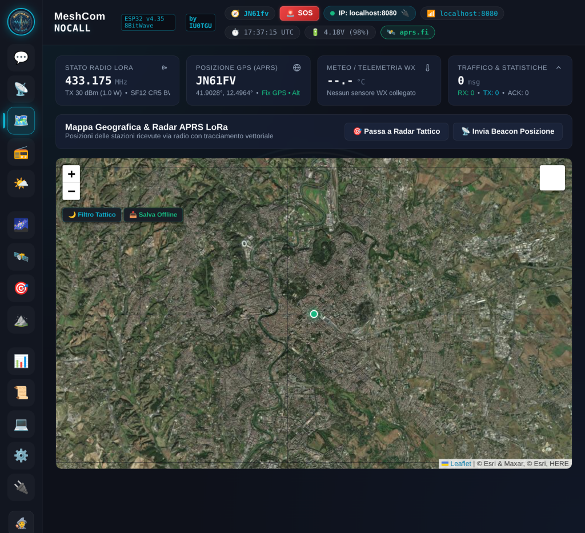
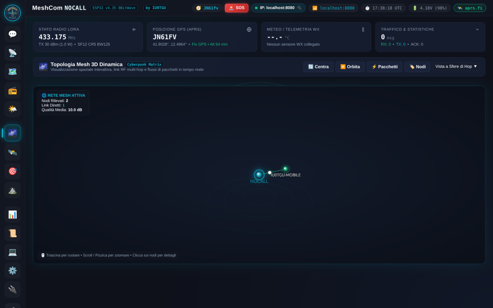
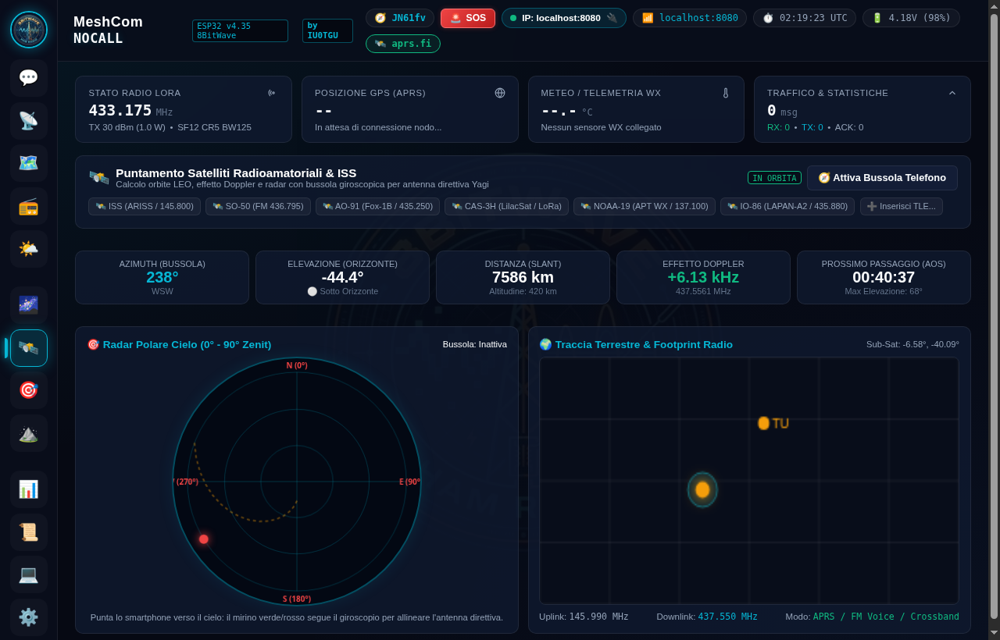
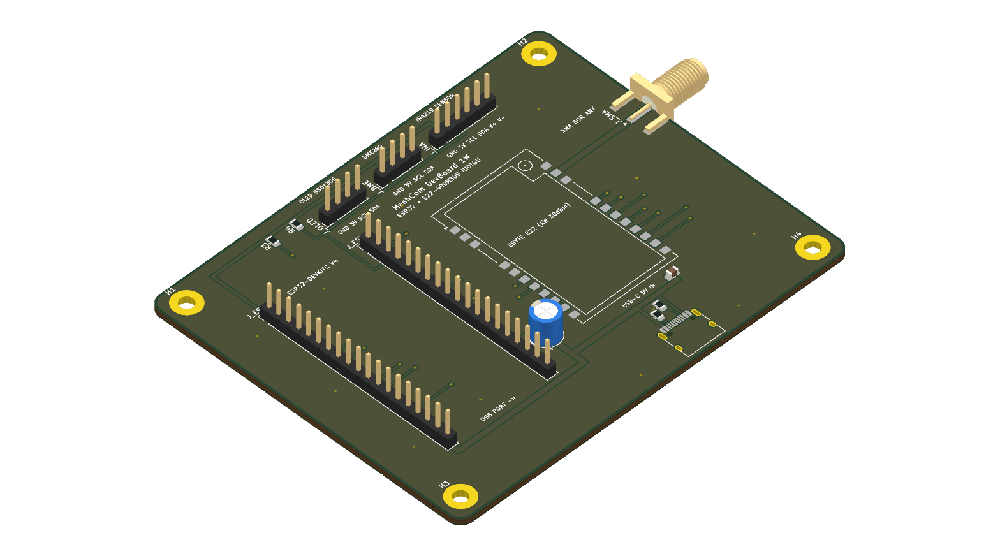
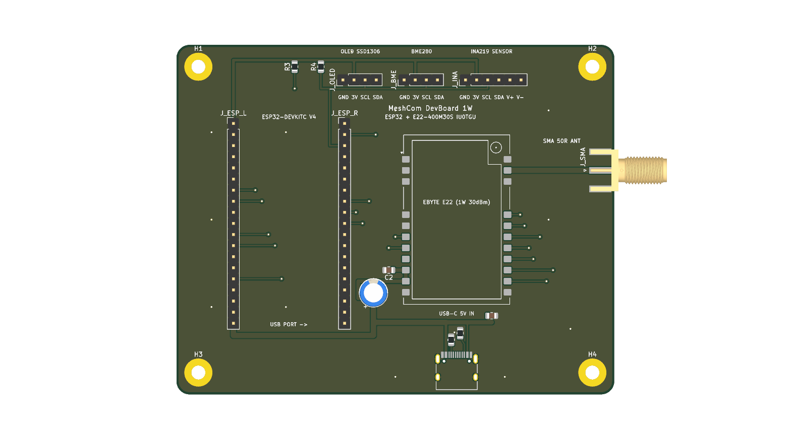

# 📡 8BitWave MeshCom v2.0
### *Autonomous Tactical LoRa Ham Radio Node, Embedded WebGUI & Android Companion*
**Designed and Engineered by IU0TGU**

[](https://icssw.org)
[]()
[](LICENSE)
[](8BitWave-MeshCom.apk)
[]()
[](hardware/)

---

<p align="center">
  
  <br />
  <em>Tactical 8-Bit WebGUI running on embedded ESP32 flash with live High-Definition Hybrid Satellite Map and real-time MHeard nodes</em>
</p>

---

## ⚡ Project Overview

**8BitWave MeshCom v2.0** is an all-in-one open-source ecosystem for autonomous tactical communications, off-grid emergency operations, and amateur radio packet routing powered by the **MeshCom 4.0** protocol. 

It provides:
- A **retro-cyberpunk 8-bit tactical WebGUI** embedded directly inside the ESP32 internal flash memory (`http://192.168.4.1`), requiring zero external internet access or cloud dependencies.
- A **lightweight standalone Android companion app** (`8BitWave-MeshCom.apk`, 1.2 MB) with instant Wi-Fi AP and Bluetooth LE auto-discovery.
- An **advanced Ham Radio tactical suite**: Real-Time SDR RF Waterfall & Spectrogram, 3D Fresnel Zone Altitudinal Link Budget, Radio Direction Finding (RDF) Triangulation, Live Amateur Satellite Tracker (ISS, SO-50, AO-91) with Sky Polar Radar, Virtual CW Morse Keyer, and Dynamic 3D Mesh Topology.
- The complete **Hardware DevBoard v2.0 (KiCad v8 + JLCPCB SMT ready)**: high-power solar repeater board with **FP6277 5.5A synchronous boost**, **CN3791 MPPT solar charger (6V–28V)**, hardware LiPo BMS, u-blox GNSS/GPS UART header with PPS interrupt, and Qwiic/STEMMA QT expansion.

```
                           ┌──────────────────────────┐
                           │   🛰️ SATELLITES & APRS   │
                           │   (ISS / SO-50 / LoRa)   │
                           └─────────────┬────────────┘
                                         ▼
┌──────────────────────┐         ┌──────────────┐         ┌──────────────────────┐
│  📱 Android App      │  BLE /  │  📡 NODE     │  LoRa   │  🌐 MeshCom Network  │
│  8BitWave-MeshCom    │◄───────►│  ESP32 / S3  │◄───────►│  Nodes & Gateways    │
│  (1.2 MB Standalone) │  Wi-Fi  │  (Flash 0x0) │ 433/868 │  National Repeaters  │
└──────────────────────┘         └──────┬───────┘         └──────────────────────┘
                                        │
                         ┌──────────────┴──────────────┐
                         │  💻 8-Bit Tactical WebGUI   │
                         │  Satellite HD Hybrid Map    │
                         │  SDR Waterfall & RF Tools   │
                         └─────────────────────────────┘
```

---

## 📥 Direct Downloads & Release Binaries

All binaries are precompiled, verified, and ready to flash:

| Package | Description | Target / File | File Size |
| :--- | :--- | :--- | :--- |
| 📱 **Android Companion App** | Native APK with instant AP & BLE scanner | [`8BitWave-MeshCom.apk`](8BitWave-MeshCom.apk) | `1.2 MB` |
| ⚡ **ESP32 + Ebyte E22** | Unified Full Flash Image (`0x0`) | [`8BitWave-MeshCom-FULL-0x0.bin`](8BitWave-MeshCom-FULL-0x0.bin) | `2.9 MB` |
| ⚡ **ESP32 + Ebyte E22** | Standard application firmware partition | [`firmware.bin`](firmware.bin) | `2.1 MB` |
| 📟 **Heltec WiFi LoRa 32 V3** | Unified Full Flash Image (`0x0`) | [`Heltec V3 FULL-0x0.bin`](firmwares/Heltec/heltec_wifi_lora_32_V3/8BitWave-MeshCom-heltec_wifi_lora_32_V3-FULL-0x0.bin) | `2.8 MB` |
| 📟 **Heltec WiFi LoRa 32 V3** | Application firmware partition | [`Heltec V3 firmware.bin`](firmwares/Heltec/heltec_wifi_lora_32_V3/8BitWave-MeshCom-heltec_wifi_lora_32_V3-firmware.bin) | `2.0 MB` |
| 🧭 **LilyGO TTGO T-Beam** | Unified Full Flash Image (`0x0`) | [`T-Beam FULL-0x0.bin`](firmwares/LilyGO/ttgo_tbeam/8BitWave-MeshCom-ttgo_tbeam-FULL-0x0.bin) | `3.0 MB` |
| 🧭 **LilyGO TTGO T-Beam** | Application firmware partition | [`T-Beam firmware.bin`](firmwares/LilyGO/ttgo_tbeam/8BitWave-MeshCom-ttgo_tbeam-firmware.bin) | `2.2 MB` |
| 🛠️ **Hardware KiCad v8** | Complete Schematic + PCB DevBoard project | [`meshcom-e22-kicad-v2.0.zip`](hardware/KiCad/meshcom-e22-kicad-project-v2.0.zip) | `4.2 MB` |
| 🏭 **JLCPCB SMT Package** | Production Gerbers, BOM, and CPL files | [`hardware/JLCPCB/`](hardware/JLCPCB/) | `Folder` |

---

## ✨ Key Tactical Features

### 🗺️ High-Definition Hybrid Satellite Map (Zero API Keys)
- **Default High-Res Imagery**: Powered by **Esri World Imagery** seamlessly layered with **Esri Boundaries and Places** vector tiles.
- **No API Keys or Accounts**: Works instantly out of the box.
- **Tactical Node Overlays**: Live markers for all received stations (`MHeard`), telemetry popups (battery voltage, altitude, RSSI/SNR, distance, last heard), and APRS trail tracking.

### 💬 Tactical Messaging & Unlimited Custom Groups
- **Standard Channels**: `ALL (Broadcast)`, `EMERGENCY 112`, `ITALIA HAM`, `DX LoRa`.
- **Custom Dynamic Channel Manager**: Create unlimited private/tactical channels with custom hex IDs (`00`–`FF`), personalized labels, and dedicated color badges. Instant channel switching and one-click deletion.
- **Auto-Mesh Routing**: Packets automatically routed across multi-hop peer nodes.

### 📶 Real-Time SDR RF Waterfall & Spectrogram
- Live interactive RF spectrum monitor on operating frequency (433.175 MHz / 868 MHz).
- Thermal waterfall spectrogram, 64-bin FFT spectrum analyzer, dynamic noise floor estimation, instantaneous RSSI, and bit error rate visualization.

<p align="center">
  
  
  <br />
  <em>Left: Live 3D Mesh Topology with dynamic physics links. Right: Amateur Satellite Tracker with Polar Sky Radar & Doppler prediction</em>
</p>

### 🧮 Ham Radio Tactical Suite (by IU0TGU)
1. **3D Fresnel Zone & RF Link Budget Calculator**:
   - Visual calculation of the 1st and 2nd Fresnel clearance zone ($R_1$) over an interactive altitudinal terrain model.
   - Computes Free Space Path Loss (FSPL in dB), antenna system gains, and fade margin for robust long-range links.
2. **Radio Direction Finding (RDF) & Triangulation**:
   - Enter multiple listening stations with geographic coordinates and received bearings.
   - Interactive polar chart calculates the geometric intersection and projects the estimated signal emitter coordinates directly onto the live satellite map.
3. **Amateur Satellite Tracker & Sky Radar**:
   - Real-time SGP4 orbital propagation for amateur radio satellites (ISS ZARYA, SO-50, AO-91).
   - Polar azimuth/elevation sky radar, global ground track map, upcoming pass predictions (AOS, LOS, MEL), and downlink Doppler shift calculator.
4. **Virtual CW Morse Code Keyer**:
   - Built-in Web Audio API tone generator with continuous sidetone oscillator.
   - Adjustable speed (10 to 35 WPM), pitch frequency control (400 to 1000 Hz), and bidirectional Text ↔ Morse code translator.
5. **Dynamic 3D Mesh Topology Canvas**:
   - Real-time force-directed 3D particle graph of all mesh nodes and active RF links, colored dynamically by SNR and hop distance.

### 📱 100% Mobile Responsive Design
- Optimized for screens from **320px smartphones to 4K ultra-wide displays**.
- Touch-friendly telemetry and MHeard tables with smooth horizontal swipe and zero viewport clipping.
- Collapsible sidebar drawer with quick tactical access.

---

## 🛠️ Hardware DevBoard v2.0 (High-Power Solar Repeater)

<p align="center">
  
  
  <br />
  <em>MeshCom E22 DevBoard v2.0 — KiCad v8 3D Photorealistic Renders (100.0 mm × 80.0 mm JLCPCB 2-Layer Standard)</em>
</p>

Designed for unattended mountaintop solar repeaters, mobile emergency field gateways, and high-power base stations:

1. **FP6277 Synchronous Boost Converter (5.5A Switch, 5V / 2.5A Continuous)**:
   - Ultra-high efficiency (>93%) synchronous architecture replacing legacy noisy converters.
   - Engineered to handle pulse RF power transients of **+30 dBm (1 Watt)** and **+33 dBm (2 Watts)** with peak supply currents up to 1.8A @ 5V without voltage sags.
2. **CN3791 MPPT Solar Charger (6V to 28V Input)**:
   - Onboard Maximum Power Point Tracking buck charger with screw terminal (**J_SOLAR**), status LEDs (`LED_CHG` Red / `LED_DONE` Green).
3. **Zero-Glitch Power-Path Management**:
   - Automatic hardware switching between solar/USB-C and 1S LiPo battery via P-MOSFET **AO3401A** and Schottky diode **SS34**.
4. **Hardware 1S LiPo BMS Protection**:
   - Dedicated protection IC **DW01A** with dual power N-MOSFETs **FS8205A** (over-discharge cutoff at 2.4V, short-circuit protection threshold at 6.0A).
5. **Precision Battery ADC Telemetry**:
   - 100 kΩ / 100 kΩ 1% resistive voltage divider with 100 nF noise filter on **GPIO 35** (`BATT_SENSE`).
6. **Hardware GNSS / GPS UART2 Interface**:
   - 5-pin header for u-blox NEO-6M / NEO-8M / Quectel GPS modules with dedicated hardware PPS (Pulse Per Second) line wired to interrupt **GPIO 4**.
7. **Modular Sensor Expansion**:
   - **STEMMA QT / Qwiic** 4-pin 1.0mm JST-SH connector for plug-and-play I2C sensors.
   - Dedicated 3-pin connector with 4.7 kΩ pull-up for Dallas **DS18B20** 1-Wire temperature probes on **GPIO 25**.
   - Standard headers for SSD1306 OLED, BME280 barometric sensor, and INA219 current/voltage sensor.

Detailed hardware design documentation, bill of materials, and KiCad schematics are available in [`hardware/README.md`](hardware/README.md).

---

## ⚡ Fast Flashing Guide

### Method 1: In-Browser Web Flasher (Recommended)
No installation required. Compatible with Google Chrome and Microsoft Edge on Windows, Linux, and macOS:
1. Connect your ESP32 board to your PC via USB cable.
2. Open the official Austrian Amateur Radio Web Flasher: **[https://esptool.oevsv.at/](https://esptool.oevsv.at/)**
3. Click **Connect** and select your USB COM/TTY serial port.
4. Select the unified **`FULL-0x0.bin`** file for your device at offset **`0x0000`**.
5. Click **Program** and wait for the flash process to complete.

### Method 2: Command Line using `esptool.py`

#### For Classic ESP32 (Ebyte E22 DevKitC / TTGO T-Beam / LoRa32):
```bash
# Replace /dev/ttyUSB0 with your actual port (e.g. COM3 on Windows)
esptool.py --chip esp32 --port /dev/ttyUSB0 --baud 921600 \
    write_flash -fm dout 0x0 8BitWave-MeshCom-FULL-0x0.bin
```

#### For ESP32-S3 (Heltec WiFi LoRa 32 V3 / T-Beam Supreme / T-Deck):
```bash
esptool.py --chip esp32s3 --port /dev/ttyACM0 --baud 921600 \
    write_flash 0x0 firmwares/Heltec/heltec_wifi_lora_32_V3/8BitWave-MeshCom-heltec_wifi_lora_32_V3-FULL-0x0.bin
```

> [!TIP]
> If `esptool` prints recurring dots (`Connecting......`), hold down the **BOOT** button (GPIO 0) on the board until flashing starts, then release it.

---

## 📱 Android Companion App

The native **`8BitWave-MeshCom.apk`** (1.2 MB) companion provides:
- **Instant Gateway Screen**: One-tap selection between **Node Hotspot (`192.168.4.1`)** and **Local Wi-Fi Network (`192.168.1.x`)**.
- **Bluetooth LE Auto-Discovery**: Direct pairing with MeshCom BLE-enabled nodes.
- **Hardware-Accelerated Mobile View**: Ultra-fast touch rendering of satellite maps, 3D topology canvas, and SDR spectrum graphs.

---

## 📋 Hardware Compatibility Matrix

All firmware images can be compiled and unified in a single command using the automated build script:
```bash
# Compile and create unified 0x0 image for Heltec V3
python3 build_all_devices.py --target heltec_wifi_lora_32_V3

# List all 26+ available hardware targets
python3 build_all_devices.py --list
```

### Supported Boards Summary:

| Manufacturer | Hardware Model | MCU Architecture | LoRa Transceiver | Display / Features | Ready Binary |
| :--- | :--- | :--- | :--- | :--- | :---: |
| **Heltec** | WiFi LoRa 32 V3 / V3.2 | ESP32-S3 | SX1262 | 0.96" OLED | ✅ Included |
| **Heltec** | WiFi LoRa 32 V4 | ESP32-S3 | SX1262 | 0.96" OLED, PMU | ⏳ Script |
| **Heltec** | WiFi LoRa 32 V2 | ESP32 | SX1276/78 | 0.96" OLED | ⏳ Script |
| **Heltec** | Wireless Stick V3 | ESP32-S3 | SX1262 | 0.49" Micro OLED | ⏳ Script |
| **Heltec** | Wireless Tracker | ESP32-S3 | SX1262 | Color TFT + GPS | ⏳ Script |
| **Heltec** | Wireless Paper / Vision Master | ESP32-S3 | SX1262 | 2.13"/2.9" E-Paper | ⏳ Script |
| **LilyGO** | TTGO T-Beam V1.1 / V1.2 | ESP32 | SX1276/78 | GPS + 18650 Battery | ✅ Included |
| **LilyGO** | TTGO T-Beam SX1262 / SX1268 | ESP32 | SX1262/68 | GPS + 18650 Battery | ⏳ Script |
| **LilyGO** | T-Beam Supreme / 1W | ESP32-S3 | SX1262 1W | Quectel L76K + PMU | ⏳ Script |
| **LilyGO** | T-Deck / Plus / Pro | ESP32-S3 | SX1262 | QWERTY Keyboard, IPS | ⏳ Script |
| **LilyGO** | T-ETH-Elite 1262 | ESP32-S3 | SX1262 | RJ45 Ethernet Gateway| ⏳ Script |
| **Ebyte DIY** | ESP32 DevKitC + E22-400M30S | ESP32 | SX1268 1W | +30 dBm (1.000 mW) | ✅ Included |
| **Ebyte DIY** | ESP32 DevKitC + E22-900M30S | ESP32 | SX1262 1W | +30 dBm 868/915MHz | ⏳ Script |
| **Ebyte DIY** | ESP32-S3 DevKitC-1 N16R8 | ESP32-S3 | SX1262/68 | 16MB Flash, 8MB PSRAM| ⏳ Script |
| **LoRa-APRS** | Tracker Boards E22 / RA-01 | ESP32 | SX1268/78 | LoRa-APRS Dedicated | ⏳ Script |


---

## 👥 Author & Acknowledgments

- **Lead Architecture & Development**: **IU0TGU** (8BitWave Project)
- **Protocol & Base Firmware**: Built upon **MeshCom 4.0** by the **ÖVSV / ICSSW** team ([icssw.org](https://icssw.org) / [esptool.oevsv.at](https://esptool.oevsv.at))
- **Satellite Map Imagery**: Esri ArcGIS Living Atlas (World Imagery & World Boundaries and Places)
- **License**: Released under the open-source **GNU General Public License v3.0 (GPL-3.0)**.
