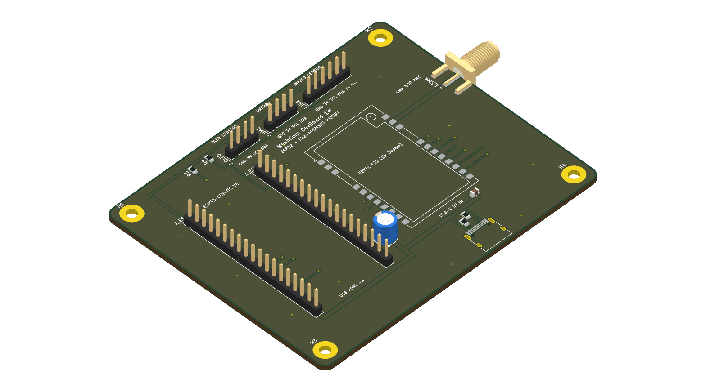
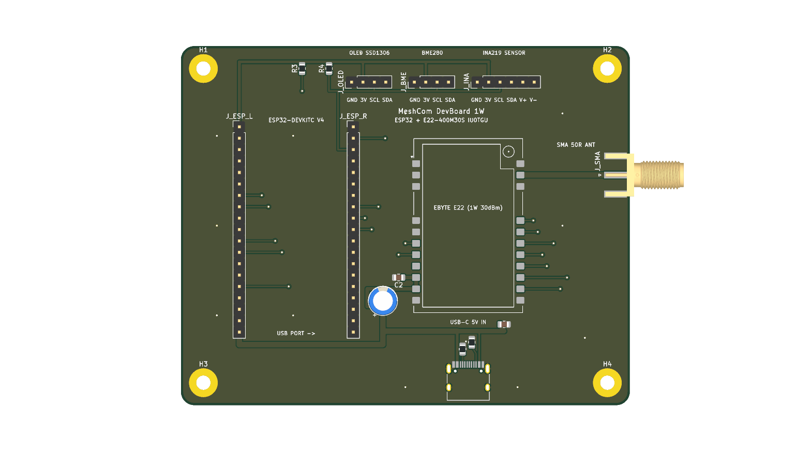

# 🛠️ MeshCom E22 DevBoard v2.0 — Hardware & PCB Guide
### *High-Power Solar Repeater & RF Gateway (1W / 2W SX1268 / SX1262)*

Open-source hardware repository and PCB archive for amateur radio nodes and **MeshCom 4.0 / Meshtastic** high-power gateways (up to **+30 dBm / 1 Watt** and **+33 dBm / 2 Watts RF**). Inspired by the **Hydra devboard** ([github.com/fzellini/meshtastic-devboard](https://github.com/fzellini/meshtastic-devboard)) and significantly upgraded with MPPT solar tracking, hardware BMS protection, high-current synchronous boost stage, dedicated GNSS/GPS UART header with PPS interrupt, and modular sensor buses.

---

<p align="center">
  
  
  <br />
  <em>Photorealistic 3D Renders of the MeshCom E22 DevBoard v2.0 (100.0 mm × 80.0 mm standard JLCPCB 2-layer)</em>
</p>

---

## 📌 Release v2.0 Architectural Upgrades

Release **v2.0** introduces a rock-solid, production-ready architecture designed for permanent mountaintop solar repeaters, mobile field gateways, and tactical base stations, strictly fitting within the standard economical dimensions of **100.0 mm × 80.0 mm** (budget tier JLCPCB 2-layer):

1. **FP6277 Synchronous Power Stage (5.5A Switch, 5V / 2.5A Continuous)**:
   - Replaces the legacy asynchronous MT3608 converter with the monolithic synchronous boost IC **FP6277** (SOP-8-EP) delivering >93% power efficiency.
   - Specifically sized to withstand heavy transmission burst transients from **+33 dBm (~2 Watts)** RF power amplifiers, handling peak impulses of **1.6A – 1.8A on the 5V rail** and cell discharge peaks up to **3.2A**.
   - Shielded 4.7 µH 4.5A power inductor (6045), dual 22 µF 16V 1206 X5R ceramic capacitors, and a bulk low-ESR 470 µF 16V electrolytic capacitor. High-current traces are widened to **0.8 mm** (continuous capacity >2.5A, peak >4.5A).

2. **Onboard CN3791 MPPT Solar Charger**:
   - Step-down buck controller with Maximum Power Point Tracking (MPPT) for photovoltaic solar panels from **6V to 28V**.
   - Heavy-duty 5.08 mm industrial screw terminal (**J_SOLAR**, Phoenix Contact MKDS).
   - Dual status LEDs: **LED_CHG** (Red - Charging) and **LED_DONE** (Green - Standby / Fully Charged).

3. **Zero-Glitch Automatic Power-Path Management**:
   - Instantaneous, uninterrupted switching between Solar/USB-C power and 1S LiPo battery via P-MOSFET **AO3401A** (30V, 4.2A) and Schottky diode **SS34** (40V, 3A).
   - When an external power source is present (USB-C or Solar Panel), system loads (ESP32 + high-power LoRa module) are driven directly from the external source without cycling the battery.

4. **Integrated 1S LiPo Battery Protection (Hardware BMS)**:
   - Polarized **JST-PH 2.0 mm 2-pin** connector (**J_BATT**).
   - Dedicated cell protection circuit with **DW01A** IC and dual power N-MOSFETs **FS8205A** (TSSOP-8, 20V 6A, $R_{DS(on)} < 25\text{ m}\Omega$).
   - Active hardware protections:
     - Overcharge cutoff: **4.25V ± 0.05V**
     - Over-discharge cutoff: **2.40V ± 0.10V**
     - Over-current / short-circuit trip threshold: **6.0A**.

5. **Precision Battery ADC Telemetry Monitor**:
   - 1% precision resistive voltage divider (100 kΩ / 100 kΩ) with 100 nF ceramic noise-filtering capacitor on **GPIO 35** (`BATT_SENSE`).
   - Maximum ADC voltage: $V_{ADC} = 4.20\text{V} / 2 = 2.10\text{V}$, completely linear and within the optimal dynamic range of the ESP32 ADC.

6. **Hardware GNSS / GPS UART2 Interface**:
   - Dedicated 5-pin 2.54 mm pitch header (**J_GPS**) for u-blox NEO-6M / NEO-8M or Quectel ATGM336H GPS modules.
   - Pinout: `+3V3`, `GPS_RXD` (ESP32 GPIO17 TX2), `GPS_TXD` (ESP32 GPIO16 RX2), `GPS_PPS` (ESP32 GPIO4), and `GND`.
   - **PPS (Pulse Per Second)** line wired to hardware interrupt for sub-millisecond time synchronization in MeshCom time-slots and APRS packet generation.

7. **Environmental Sensor Expansion (Qwiic / STEMMA QT + 1-Wire + I2C)**:
   - **STEMMA QT / Qwiic JST-SH 1.0 mm 4-pin** horizontal connector (**J_QWIIC**) for solderless plug-and-play connection with Adafruit and SparkFun sensor modules.
   - Dedicated 3-pin connector with 4.7 kΩ pull-up resistor for Dallas **DS18B20** 1-Wire temperature probes (**J_DS18**) on **GPIO 25**.
   - Standard I2C headers for SSD1306/SH1106 OLED displays (**J_OLED**), BME280/BMP280 barometric sensors (**J_BME**), and INA219 bidirectional voltage/current monitors (**J_INA**).
   - Onboard I2C pull-up resistors: **2.2 kΩ** on SDA (GPIO 21) and SCL (GPIO 22).

---

## 🔌 Complete Hardware Pinout Mapping (ESP32 DevKitC v4 38-Pin)

| Hardware Signal | Ebyte E22 Module | Connectors / Peripherals | ESP32 Pin | Role in MeshCom Firmware |
| :--- | :--- | :--- | :--- | :--- |
| **LoRa SCK** | Pin 18 (SCK) | — | **GPIO 18** | Hardware SPI clock for Semtech SX126x |
| **LoRa MISO** | Pin 16 (MISO) | — | **GPIO 19** | Master In Slave Out SPI bus |
| **LoRa MOSI** | Pin 17 (MOSI) | — | **GPIO 23** | Master Out Slave In SPI bus |
| **LoRa NSS / CS** | Pin 19 (NSS) | — | **GPIO 5** | LoRa Chip Select (Active Low) |
| **LoRa NRST** | Pin 15 (NRST) | — | **GPIO 33** | Hardware reset line |
| **LoRa BUSY** | Pin 14 (BUSY) | — | **GPIO 27** | SX126x transceiver busy status |
| **LoRa DIO1** | Pin 13 (DIO1) | — | **GPIO 32** | Packet RX/TX done interrupt (RX_DONE) |
| **E22 RXEN** | Pin 6 (RXEN) | — | **GPIO 14** | RF Switch: LNA enable in RX mode |
| **E22 TXEN** | Pin 7 (TXEN) | — | **GPIO 13** | RF Switch: PA enable in TX mode |
| **GPS TXD (Data Out)**| — | `J_GPS` Pin 3 (TXD) | **GPIO 16** | UART2 RX ESP32 (NMEA sentence reception) |
| **GPS RXD (Data In)** | — | `J_GPS` Pin 2 (RXD) | **GPIO 17** | UART2 TX ESP32 (GNSS configuration) |
| **GPS PPS** | — | `J_GPS` Pin 4 (PPS) | **GPIO 4** | 1 Hz time-pulse synchronization |
| **1-Wire Data** | — | `J_DS18` Pin 2 (DAT) | **GPIO 25** | Dallas DS18B20 digital temperature bus |
| **Battery ADC Sense** | — | R_BAT1/R_BAT2 Divider | **GPIO 35** | Analog voltage read (divided by 2) |
| **I2C SCL** | — | OLED, BME280, INA, QWIIC | **GPIO 22** | I2C Clock (2.2 kΩ onboard pull-up) |
| **I2C SDA** | — | OLED, BME280, INA, QWIIC | **GPIO 21** | I2C Data (2.2 kΩ onboard pull-up) |
| **USER / BOOT** | — | ESP32 DevKitC Module | **GPIO 0** | User function / Firmware bootloader |
| **Activity LED** | — | ESP32 DevKitC Module | **GPIO 2** | Packet RX/TX activity indicator |

---

## ⚡ Power Supply Sizing: 30 dBm (1W) vs 33 dBm (2W) Modules

### Electrical Budgets & Current Consumption:

1. **Ebyte E22-400M30S / E22-900M30S (1 Watt RF / +30 dBm)**:
   - RF stage nominal voltage: **5.0V**
   - Peak current in transmission (+30 dBm): **~650 mA – 750 mA**
   - Peak RF power consumption: **~3.5W – 3.8W**
   - Current draw from LiPo cell (3.7V nominal, 93% efficiency): **~1.1A**

2. **Ebyte E22-400M33S / E22-900M33S (2 Watts RF / +33 dBm)**:
   - RF stage nominal voltage: **5.0V**
   - With PA efficiency around 40–45%, total power drawn during transmission bursts reaches **~8W – 9W**.
   - Peak continuous current (+33 dBm): **~1.6A – 1.8A on the 5V rail**.
   - Peak instantaneous current drawn from LiPo cell (at 3.3V near depletion, 92% efficiency): **~3.0A – 3.2A**.

### Hardware Design Mitigation:
- The **FP6277** converter delivers up to **2.5A continuous and 5.5A switch current**, easily satisfying the +33 dBm amplifier requirements without voltage drops.
- Shielded **4.7 µH inductor with 4.5A saturation current** prevents thermal throttling and core saturation during long LoRa transmission packets.
- **Thermal Dissipation**: When operating 33 dBm modules with high duty cycles (repeaters or high-rate beacons), applying a 1.0 mm thermal silicone pad under the metal shield to interface with the PCB bottom ground plane is recommended.

---

## 📁 Repository Hardware Files

```text
hardware/
├── KiCad/
│   ├── meshcom-e22-devboard.kicad_pro   # KiCad v8 project file
│   ├── meshcom-e22-devboard.kicad_sch   # Hierarchical schematic v2.0
│   ├── meshcom-e22-devboard.kicad_pcb   # 2-layer routed PCB layout (0 DRC errors)
│   ├── meshcom-e22-devboard.kicad_prl   # Workspace settings
│   └── meshcom-e22-kicad-project-v2.0.zip# Complete zipped project
│
├── JLCPCB/
│   ├── gerbers.zip                      # Production Gerber & drill files
│   ├── bom.csv                          # Full Bill of Materials with LCSC part numbers
│   ├── cpl.csv                          # Pick-and-Place (CPL / Centroid) coordinates
│   ├── jlcpcb_bom_smd_only.csv          # SMT-only components BOM
│   ├── jlcpcb_cpl_smd_only.csv          # SMT-only placement CPL
│   └── assembly.zip                     # Ready package for JLCPCB SMT quote
│
├── Exports/                             # Vector schematics and mechanical drawings
│   ├── meshcom-e22-pcb-v2.0.pdf         # Printable PCB drawing (scale 1:1)
│   ├── meshcom-e22-schematic-v2.0.pdf   # Printable schematic PDF
│   ├── meshcom-e22-schematic-v2.0.svg   # Vector SVG schematic
│   ├── meshcom-e22-pcb-top.svg          # Top copper and silkscreen vector
│   └── meshcom-e22-pcb-bottom.svg       # Bottom copper vector
│
└── Renders/                             # 3D Graphic assets
    ├── render_top.png                   # Top view render
    └── render_isometric.png             # Isometric 3D view render
```

---

## 🛒 Bill of Materials (BOM with LCSC Part Numbers)

All passive and active SMD components have been selected from standard high-availability components in the JLCPCB / LCSC catalog:

| Reference | Component Description | Footprint | LCSC Part # | Assembly Type |
| :--- | :--- | :--- | :--- | :--- |
| **U_BOOST** | FP6277 Synchronous Boost Converter 5V 2.5A | SOIC-8-EP | **C2895690** | SMD (Top) |
| **U_MPPT** | CN3791 MPPT Solar Charger 6-28V | SSOP-10 | **C2939886** | SMD (Top) |
| **U_BMS** | DW01A 1S LiPo Battery Protection IC | SOT-23-6 | **C39702** | SMD (Top) |
| **Q_BMS** | FS8205A Dual N-MOSFET 20V 6A | TSSOP-8 | **C47738** | SMD (Top) |
| **Q_PWR** | AO3401A P-MOSFET Power-Path 30V 4.2A | SOT-23 | **C15127** | SMD (Top) |
| **D_USB, D_MPPT** | SS34 Schottky Barrier Diode 40V 3A | SMA (DO-214AC) | **C1586** | SMD (Top) |
| **L_BOOST** | Shielded Power Inductor 4.7 µH 4.5A (6045) | SMD 6.3×6.3 mm | **C517036** | SMD (Top) |
| **L_MPPT** | Shielded Power Inductor 10 µH 3.0A (6045) | SMD 6.3×6.3 mm | **C517038** | SMD (Top) |
| **C_BST_IN, C_BST_OUT, C_BAT_CHG** | Ceramic Capacitor 22 µF 16V X5R | SMD 1206 | **C12882** | SMD (Top) |
| **C_SOL** | Ceramic Capacitor 10 µF 50V X7R | SMD 1206 | **C96979** | SMD (Top) |
| **C2, C3, C_BAT** | Ceramic Capacitor 100 nF 50V X7R | SMD 0805 | **C49678** | SMD (Top) |
| **C1** | Bulk Electrolytic Capacitor 470 µF 16V | Radial D6.3 mm P2.5 mm | **C331295** | Through-Hole |
| **R1, R2** | Precision Resistor 5.1 kΩ 1% | SMD 0805 | **C27834** | SMD (Top) |
| **R3, R4** | Precision Resistor 2.2 kΩ 1% (I2C Pull-Up) | SMD 0805 | **C17520** | SMD (Top) |
| **R_BAT1, R_BAT2** | Precision Resistor 100 kΩ 1% (ADC Divider) | SMD 0805 | **C17407** | SMD (Top) |
| **R_OW** | Precision Resistor 4.7 kΩ 1% (1-Wire Pull-Up) | SMD 0805 | **C17673** | SMD (Top) |
| **LED_CHG** | 0805 SMD LED Red (Charging Indicator) | SMD 0805 | **C2286** | SMD (Top) |
| **LED_DONE** | 0805 SMD LED Green (Charged Indicator) | SMD 0805 | **C2290** | SMD (Top) |
| **J_USB** | USB Type-C 16-pin Receptacle (TYPE-C-31-M-12) | USB-C SMD/Hybrid | **C165948** | SMD / Through-Hole |
| **J_QWIIC** | STEMMA QT / Qwiic I2C Receptacle (SM04B) | JST-SH 1.0 mm 4P Horiz | **C160404** | SMD (Top) |
| **J_BATT** | LiPo Battery Header JST-PH 2.0 mm 2P | JST-PH Horizontal | **C131337** | Through-Hole |
| **J_SOLAR** | Solar Screw Terminal Block 2P Pitch 5.08 mm | Phoenix Contact MKDS | **C8379** | Through-Hole |
| **J_SMA** | SMA EdgeMount 50Ω Jack for PCB | SMA EdgeMount Amphenol | **C494294** | EdgeMount SMD |
| **J_GPS** | Pin Header 1×05 Pitch 2.54 mm Vertical | Pin Header 2.54 mm | **C2897385** | Through-Hole |
| **J_DS18** | Pin Header 1×03 Pitch 2.54 mm Vertical | Pin Header 2.54 mm | **C2897383** | Through-Hole |
| **J_ESP_L, J_ESP_R** | Female Header Socket 1×19 Pitch 2.54 mm | Pin Socket 2.54 mm | **C225578** | Through-Hole |
| **J_OLED** | Female Header Socket 1×04 Pitch 2.54 mm | Pin Socket 2.54 mm | **C224375** | Through-Hole |
| **J_BME** | Pin Header 1×04 Pitch 2.54 mm Vertical | Pin Header 2.54 mm | **C2897384** | Through-Hole |
| **J_INA** | Pin Header 1×06 Pitch 2.54 mm Vertical | Pin Header 2.54 mm | **C2897386** | Through-Hole |
| **U2** | Ebyte E22-400M30S or E22-900M30S Module | E22 Castellated SMD | *(DNP / Hand Solder)* | SMD |

---

## 🏭 JLCPCB Fabrication & Assembly Instructions

1. **Upload Production Files**:
   - Go to [jlcpcb.com](https://jlcpcb.com) and upload `JLCPCB/gerbers.zip`.
   - Recommended PCB settings:
     - **PCB Dimensions**: **100.0 mm × 80.0 mm** (auto-detected).
     - **Layers**: **2 Layers**.
     - **PCB Thickness**: **1.6 mm**.
     - **Surface Finish**: **ENIG (Electroless Nickel Immersion Gold)** is strongly recommended for 50Ω RF coplanar waveguide impedance stability and reliable soldering of E22 castellated pads. Alternatively, select **HASL Lead-Free**.
     - **Solder Mask Color**: Matte Black, Blue, or Classic Green.
     - **Copper Weight**: 1 oz (35 µm).

2. **Automated SMT Assembly**:
   - Check **SMT Assembly** -> **Top Side**.
   - Upload `JLCPCB/bom.csv` (or `jlcpcb_bom_smd_only.csv`) for the Bill of Materials.
   - Upload `JLCPCB/cpl.csv` (or `jlcpcb_cpl_smd_only.csv`) for component placement coordinates.
   - Verify component orientations in the JLCPCB 3D alignment viewer (pin 1 markers and diode polarities are already pre-aligned to IPC-7351 standards).
   - The Ebyte E22 module (**U2**) is marked as **DNP (Do Not Populate)** so you can hand-solder your desired band module (433 MHz vs 868/915 MHz, 30 dBm vs 33 dBm).

---

## 🔬 DRC & Electrical Benchmark Verification

- **KiCad Design Rules Check (DRC)**:
  - Clearance violations: **0**
  - Unconnected nets: **0**
  - Footprint / Pad errors: **0**
  - Power rail to ground plane isolation: **≥ 0.35 mm** (exceeds standard safety clearances).
  - Ground planes (`F.Cu` and `B.Cu`) are solidly stitched together with thermal via arrays underneath the RF module and boost inductor.
